# Trading Crypto Bot

Bot de trading spot para pares em USDT, com interface web local, Docker e histórico para análise de
longo prazo. Feito em Python com FastAPI, `ccxt`, SQLite e PostgreSQL.

**Este projeto só opera na Spot Testnet da Binance, com saldo fictício.** Não existe configuração
para modo real, e o bot se recusa a iniciar se as rotas de negociação não forem da testnet.

## Situação atual

- As sete estratégias ainda precisam ser comparadas com dados reais em 4h e 1d. Até agora, a de
  máximas e mínimas foi **reprovada** em BTC/USDT em 1h.
- As estratégias são exemplos para estudo. Elas não são recomendação de investimento nem promessa de
  lucro.
- O OCO, as ordens limitadas e as operações manuais ainda precisam de mais tempo de uso na testnet real.

## Início rápido com Docker

No Windows, dê dois cliques em `Iniciar-Docker.bat`. Ele:

1. Oferece instalar o Docker Desktop, se necessário. Depois disso, pode ser preciso reiniciar o
   Windows, abrir o Docker Desktop uma vez e rodar o arquivo de novo.
2. Abre o Docker, se estiver fechado.
3. Cria o `.env` com uma senha aleatória, se ele não existir.
4. Sobe o bot e o PostgreSQL.
5. Abre http://127.0.0.1:8766.

Sem o arquivo `.bat`, com o Docker aberto, rode:

```bash
cp .env.example .env           # Windows: copy .env.example .env
docker compose up -d --build
```

Se criar o `.env` manualmente, troque `POSTGRES_PASSWORD` antes do primeiro início, usando só letras
e números. Depois de criar o banco, mudar esse valor não altera a senha dele.

O código de `bot/` e `main.py` fica ligado à pasta do projeto, sem precisar de build. Ao salvar um
arquivo Python, o app tenta reiniciar sozinho. No Windows, se a mudança não aparecer, rode
`docker compose restart bot`. Alterações na interface aparecem ao atualizar a página com Ctrl + F5. Só é preciso
`docker compose up -d --build` quando mudarem `Dockerfile` ou `requirements*.txt`. Depois de um
reinício automático, o bot religa se a configuração não tiver mudado.

Comandos úteis:

```bash
docker compose ps               # situação dos contêineres
docker compose logs -f bot      # registros do bot
docker compose down             # desliga e mantém os dados
docker compose down -v          # APAGA banco, posições e configurações
```

Os contêineres voltam quando o Docker reinicia. O bot religa sozinho se estava ligado, com a mesma
configuração. Se você o desligou ou todos os pares pararam, ele continua desligado.

## Como usar

1. **Conectar:** gere uma chave HMAC em https://testnet.binance.vision e cole na interface. Esta tela
   some quando as chaves já estão no `.env`.
2. **Estratégia e risco:** escolha os pares, a estratégia, o tempo gráfico e os limites. Depois, clique em
   **Testar estratégia** e ligue na testnet.
3. **Painel:** acompanhe e controle as operações.
4. **Carteira:** veja o total da conta e o capital em cada ativo.
5. **Histórico:** analise o resultado, as taxas e cada par, com filtros e exportação em CSV.

O bot só liga depois de testar a configuração atual. Se ela for reprovada, ainda é possível ligar na
testnet para testar o sistema.

As imagens da interface usam dados simulados.

### Estratégia e risco

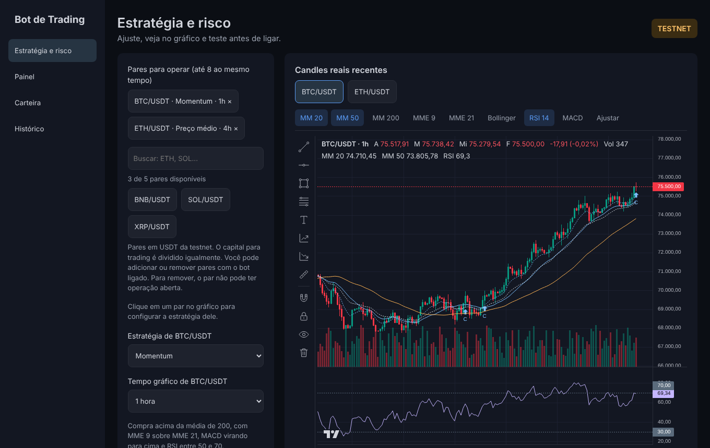

### Painel

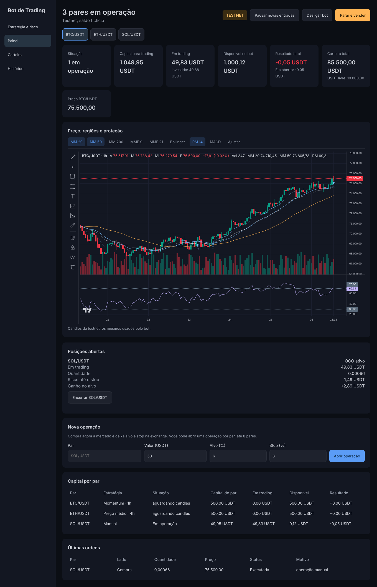

### Carteira

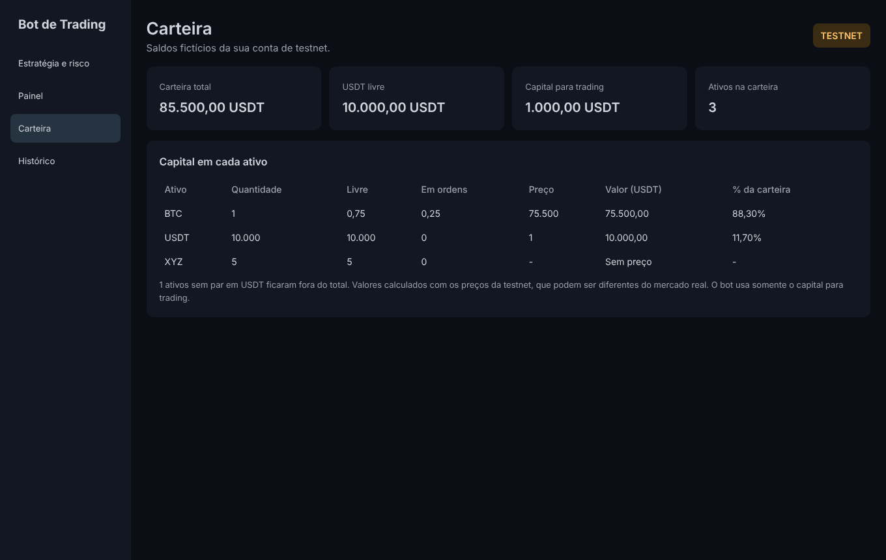

### Histórico

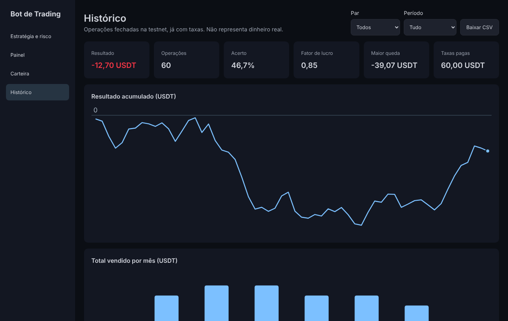

## Estratégias

As imagens abaixo são ilustrações para explicar a ideia de cada estratégia. Elas não mostram operações
reais. Nenhuma estratégia garante lucro, e cada uma vai pior em certos tipos de mercado.

| Estratégia | Tende a ir melhor em | Principal risco | Saída |
|---|---|---|---|
| [Máximas e mínimas](#máximas-e-mínimas-ranges) | Mercado lateral | Rompimento do suporte | OCO |
| [Médias móveis](#médias-móveis-sma) | Tendências longas | Sinais falsos em mercado lateral | Cruzamento ou OCO |
| [Preço médio](#preço-médio-dca) | Quedas com recuperação | Capital preso e perda grande | Venda limitada |
| [Rompimento](#rompimento-breakout) | Início de movimentos fortes | Rompimentos falsos | OCO |
| [Reversão à média](#reversão-à-média-reversion) | Mercado sem tendência | A queda continuar | OCO |
| [Momentum](#momentum-momentum) | Altas fortes | Reversões rápidas | OCO ou reversão |
| [Grid](#grid-grid) | Mercado lateral | Queda forte e capital preso | Venda limitada por nível |

### Termos usados

- **Candle:** barra de preço de um período, com abertura, máxima, mínima e fechamento.
- **Suporte e resistência:** menor e maior fechamento da região observada.
- **Stop:** preço em que a posição é vendida para limitar a perda.
- **Alvo:** preço em que a posição é vendida com ganho.
- **OCO:** duas ordens ligadas, alvo e stop. Quando uma executa, a outra é cancelada.
- **RSI:** indicador de 0 a 100 que mede a força recente do preço.
- **MACD:** indicador que compara médias móveis para mostrar mudança de ritmo.
- **Bollinger:** faixas acima e abaixo de uma média, que abrem conforme a volatilidade aumenta.

### Máximas e mínimas (`ranges`)

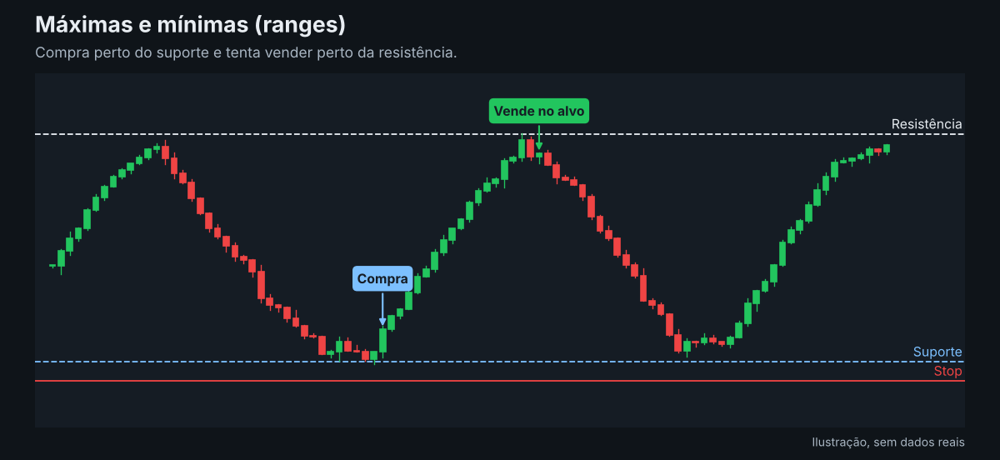

Procura uma região em que o preço oscila. O bot compra na parte baixa da região, depois de um candle
de alta, se o alvo pagar pelo menos `MIN_REWARD_RISK` vezes o risco. Ele não compra se o fechamento
romper o suporte.

- **Ajustes:** candles da região, zona de compra e ganho mínimo por risco.
- **Cuidado:** quando o suporte rompe, a região deixa de valer, e o stop limita a perda.

### Médias móveis (`sma`)

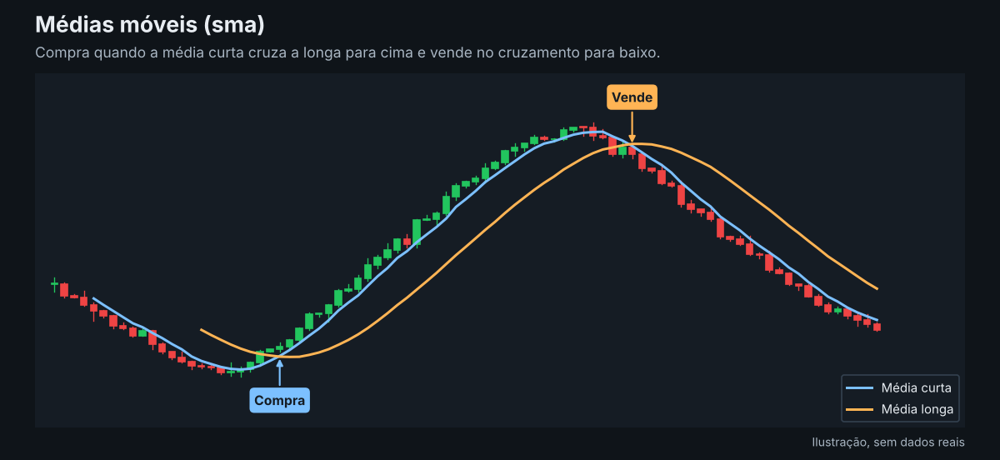

Segue a tendência. Compra quando a média curta cruza a média longa para cima e vende no cruzamento para
baixo, se o alvo ou o stop não executarem antes.

- **Ajustes:** média curta, média longa e stop.
- **Cuidado:** em mercado lateral, as médias cruzam muitas vezes e as taxas pesam. Em um backtest de
  BTC/USDT em 1h, a configuração padrão perdeu dinheiro.

### Preço médio (`dca`)

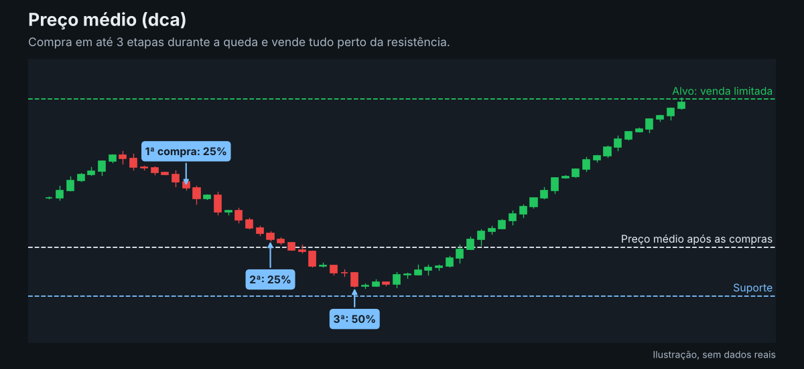

Compra em até três etapas: 25% do capital do par abaixo do meio da região, 25% no meio do caminho até o
suporte e 50% perto do suporte. A venda limitada perto da resistência é atualizada a cada compra. O
bot para de comprar se o preço cair 5% abaixo do suporte.

- **Ajustes:** candles da região, capital e stop de catástrofe opcional.
- **Cuidado:** sem stop, o bot não vende no prejuízo, mas a perda fica em aberto. O preço pode não voltar,
  e quase todo o capital do par pode ser perdido. O limite de perda diária não vale nesse modo.

### Rompimento (`breakout`)

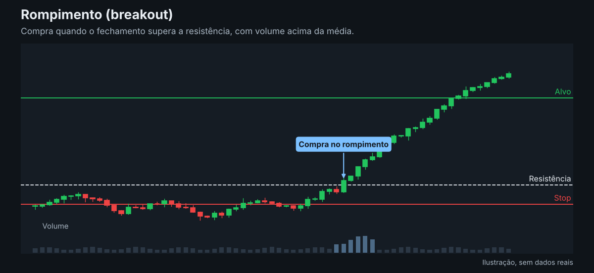

Aposta que o preço vai continuar subindo depois de sair da região. O bot compra quando o fechamento
supera a resistência, em candle de alta, com volume 1,5 vez acima da média de 20 candles.

- **Ajustes:** candles da região, ganho por risco e stop.
- **Cuidado:** muitos rompimentos falham e voltam para a região.

### Reversão à média (`reversion`)

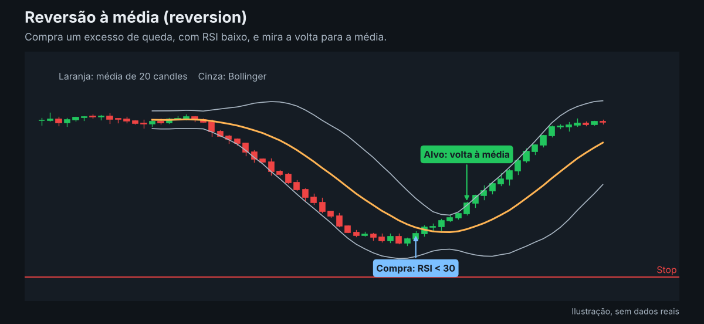

Procura quedas exageradas. O bot compra com RSI abaixo de 30, fechamento abaixo da Bollinger inferior e
candle de alta. O alvo é a média de 20 candles.

- **Ajuste:** stop.
- **Cuidado:** em uma tendência de queda, o preço pode continuar caindo mesmo com RSI baixo.

### Momentum (`momentum`)

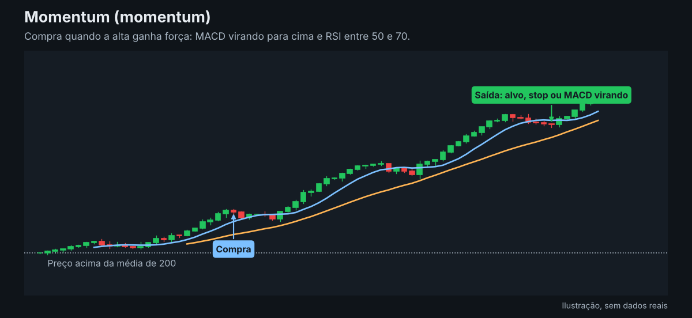

Compra força que já existe. Exige preço acima da média de 200, MME 9 sobre MME 21, MACD virando para cima e
RSI entre 50 e 70. Vende no alvo, no stop ou quando o MACD e as MMEs viram para baixo.

- **Ajustes:** ganho por risco e stop.
- **Cuidado:** a entrada acontece depois da alta começar, e o preço pode virar rápido.

### Grid (`grid`)

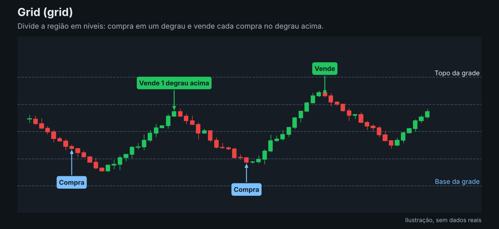

Divide a região em níveis iguais. Cada nível tem uma compra limitada e, depois de comprar, uma venda no
nível acima. Cada ida e volta aparece como uma operação no histórico.

- **Ajustes:** candles da região, níveis da grade, capital e stop de catástrofe opcional.
- **Cuidado:** as vendas fechadas podem parecer ótimas enquanto as compras presas acumulam perda. Se o
  preço sair da grade para baixo, o capital fica preso. O limite de perda diária não vale nesse modo.

### Swing trade

Swing trade é um horizonte de tempo, não uma regra de entrada. Para operar assim, use **4 horas** ou
**1 dia** em qualquer estratégia. O bot faz menos operações, e cada uma tende a durar de dias a semanas.

Scalping e arbitragem não estão disponíveis. O bot checa o mercado a cada 30 segundos e opera em uma
só exchange.

## Vários pares

Escolha até 8 pares em USDT na interface ou em `SYMBOLS` no `.env`. O capital é dividido igualmente,
e cada par tem limites e arquivo de dados próprios (`bot_BTCUSDT.db`, por exemplo). Se um par parar,
os outros continuam.

Com o bot ligado, você pode adicionar ou remover pares em **Estratégia e risco**. O capital é
redividido na hora. Um par com operação aberta só pode ser removido depois de encerrada. Na grade, as
ordens abertas do par removido são canceladas.

Cada par pode ter sua própria estratégia e seu próprio tempo gráfico. Clique no par acima do gráfico
e mude **Estratégia** e **Tempo gráfico**. Isso também funciona com o bot ligado, desde que o par não
tenha posição aberta. Os outros ajustes, como capital e risco, valem para todos os pares. Pares sem USDT, como ETH/BTC, ainda não são aceitos.

## Gráfico

O gráfico usa a [Lightweight Charts](https://www.tradingview.com/lightweight-charts/) da TradingView.
Ele mostra abertura, máxima, mínima, fechamento, variação e volume da vela sob o cursor, com zoom e
arraste. Você pode ligar médias móveis, MME, Bollinger, RSI 14 e MACD. Em **Estratégia e risco**, os
candles são da Binance real. No **Painel**, são da testnet, os mesmos usados pelo bot.

A barra lateral tem linha de tendência, linha horizontal, retângulo, Fibonacci, texto, posição long,
posição short, régua, ímã, travar, ocultar e apagar. Os desenhos ficam salvos no navegador, separados
por par e tela. Eles só servem para análise: o bot não usa essas linhas para operar.

Nas posições long e short, clique na entrada, no stop e no alvo. O desenho mostra as porcentagens e o
risco/retorno. A posição short é só uma simulação visual, porque o bot opera apenas no spot.

Para excluir um desenho, clique nele e depois no **×** vermelho, na lixeira ou na tecla Delete.

## Carteira e capital

A aba **Carteira** mostra o total da conta de testnet, o USDT livre e o saldo de cada ativo, com
quantidade, valor em ordens, preço e percentual. A lista de pares disponíveis aparece em
**Estratégia e risco**. O bot opera até 8 pares ao mesmo tempo, com uma posição por par.

- **Carteira total:** valor estimado de toda a conta, incluindo o que o bot não usa.
- **Capital para trading:** parte que o bot pode usar, mais o resultado realizado e em aberto.
- **Em trading:** valor atual das posições abertas, com o total investido logo abaixo.
- **Disponível no bot:** parte do capital que não está em posições.
- **Resultado total:** diferença para o capital inicial, com o valor em aberto logo abaixo.

## Operações no painel

Com o bot ligado, **Nova operação** compra a mercado em um par e deixa alvo e stop na exchange. Ela
pode usar um par fora da lista da estratégia, com uma operação por par e até 8 pares ao todo. Essas
operações continuam depois de reiniciar. Cada posição tem o botão **Encerrar**, que vende só aquela
posição e mantém o bot ligado. Na grade, ele vende todos os níveis comprados daquele par.

Com o bot desligado, o **Painel** continua mostrando as posições salvas. O botão **Religar bot** volta
a acompanhá-las sem exigir um novo teste. Encerrar uma posição exige o bot ligado.

## Gestão de risco

Os controles podem ser alterados com o bot ligado. O capital e os limites valem na hora para novas
decisões. Alvo, stop e ordens já enviados à exchange não mudam.

- **Tamanho:** por padrão, cada par arrisca 1% da sua parte do capital até o stop e usa no máximo 25%
  dela em uma posição.
- **Capital:** `CAPITAL_USDT` limita o total do bot. Ele só vende o que ele mesmo comprou.
- **Perda diária:** em `ranges`, `sma`, `breakout`, `reversion` e `momentum`, ao perder 3% no dia (UTC),
  o par vende a posição e para. Em `dca` e `grid`, esse limite não vale.
- **OCO:** nas estratégias com stop, o bot envia alvo e stop à exchange depois da compra. Se o preço
  passar direto pelo stop limitado com o bot ligado, ele vende a mercado.
- **Sem proteção, sem posição:** se o OCO for recusado, o bot vende a posição e para aquele par.
- **Recuperação:** ordens e posições ficam no arquivo de cada par. Se a resposta de uma ordem ou de um
  OCO se perder, o bot para e confere na exchange ao reiniciar.

## Histórico e banco de dados

Cada operação fechada fica na tabela `trades`, com datas, preços, taxas, resultado, motivo da saída e
parâmetros usados. Cada teste fica em `validation_runs`.

Operações abertas ficam no arquivo do par e na exchange, não em `trades`. Depois de fechada, a operação
é gravada primeiro no arquivo do par e depois enviada ao banco. Assim, uma queda do banco
não perde o registro nem para o bot. No Docker, o histórico fica no PostgreSQL. Fora dele, fica em
`trades.db`.

Para abrir o PostgreSQL em outra ferramenta, use `127.0.0.1:5433`, banco `trading`, usuário `bot` e a
senha `POSTGRES_PASSWORD`. Para fazer uma cópia de segurança:

```bash
docker compose exec postgres pg_dump -U bot trading > backup-trading.sql
```

Os valores ficam em USDT. Para fins de imposto, cada venda precisa ser convertida para reais na data
da operação. As operações na testnet usam saldo fictício.

## Rodar sem Docker

Instale o Python 3.10 ou mais novo. No Windows, dê dois cliques em `Iniciar.bat`. No Linux ou Mac,
rode `./iniciar.sh`. A interface abre em http://127.0.0.1:8765.

Não rode as duas versões ao mesmo tempo. Fechar a janela do bot o desliga, mas uma posição aberta
continua com o OCO na exchange.

Instalação manual e comandos de terminal:

```bash
python -m venv .venv
source .venv/bin/activate             # Windows: .venv\Scripts\activate
pip install -r requirements.txt
cp .env.example .env                  # Windows: copy .env.example .env

pytest                                # testes
python main.py ui                     # interface
python main.py validate               # escolhe e confirma parâmetros em períodos separados
python main.py backtest               # backtest com candles reais, sem chave
python main.py backtest --synthetic   # dados simulados, sem internet
python main.py backtest --csv dados.csv
python main.py check                  # valida chaves e saldo na testnet
python main.py run                    # bot com painel no terminal
python main.py run --no-panel         # bot com logs no terminal
```

Os ajustes da interface ficam em `settings.json`, que tem prioridade sobre o `.env`. O CSV precisa
das colunas `timestamp` (em ms), `open`, `high`, `low`, `close` e `volume`.

No terminal, para uma parada de emergência, crie um arquivo chamado `STOP` na pasta do bot. Ele
cancela o OCO, vende a posição e encerra. Apague o arquivo antes de iniciar de novo.

## Testes

- **Backtest:** executa o sinal na abertura seguinte, com taxa de 0,1% e slippage de 0,05%. Se o stop
  e o alvo cabem no mesmo candle, conta o stop.
- **Aprovação:** a configuração precisa de 20 operações, lucro e resultado melhor que segurar o ativo
  com a mesma exposição média nos dois períodos testados.
- **Interface:** testa a configuração escolhida em cada par, com a estratégia e o tempo gráfico dele.
- **`python main.py validate`:** em `ranges`, escolhe os parâmetros nos primeiros 70% dos dados e
  confirma nos 30% finais. Nas outras estratégias, testa os ajustes atuais nos dois períodos.
- **Testes automatizados:** `pytest` cobre estratégias, ordens, recuperação depois de queda, interface
  e histórico. Com `TEST_POSTGRES_URL` definido, também roda os testes no PostgreSQL.

Ajustar várias vezes nos mesmos dados, ou escolher só os pares aprovados, deixa o resultado otimista.
Uma aprovação não garante lucro futuro.

## Limitações

- O stop de catástrofe do preço médio e do grid fica no bot, não na exchange. Com o bot desligado, ele não age.
- O stop OCO é limitado. Com o bot desligado, uma queda muito rápida pode passar por ele sem executar.
- Os limites são por par. Se várias criptos caírem juntas, as perdas se somam até o limite total.
- O gráfico e os testes usam candles reais, mas o bot opera com os preços e a liquidez da testnet.
- A testnet é zerada cerca de uma vez por mês, sem aviso. Se o bot avisar que o OCO sumiu ou que o
  saldo não cobre a posição, confira a testnet e apague os arquivos `bot_*.db*` antes de ligar de
  novo. No Docker, use `docker compose exec bot sh -c 'rm -f /data/bot_*.db*'`. O histórico continua
  no banco.
- Taxas pagas em BNB não entram no lucro calculado pelo bot. Em vendas consultadas depois, como OCO e
  venda limitada, a taxa é estimada em 0,1%.
- Um sinal é perdido se o bot cair entre registrar o candle e enviar a ordem. É uma escolha para
  evitar ordem duplicada.
- Depois de parar pelo limite diário, um reinício no mesmo dia (UTC) para de novo. No dia seguinte,
  volta a operar.

## Resolução de problemas

| Situação | O que fazer |
|---|---|
| A página não abre em `127.0.0.1:8766` | Rode `docker compose ps -a` e `docker compose logs --tail=40 bot`. |
| Erro de porta em uso ao subir | Outra cópia do bot ocupa a porta. Use só a versão Docker, na 8766, e feche o `Iniciar.bat`. |
| A tela não mostra as mudanças | Atualize com **Ctrl + F5**. Se mudou Python, rode `docker compose restart bot`. |
| Painel mostra **Desligado, com posições** | Clique em **Religar bot**. Alvo e stop na exchange continuam ativos enquanto isso. |
| Um par aparece como parado | O motivo aparece no Painel. Corrija, desligue e ligue o bot de novo. |
| O bot avisa que o OCO, a venda ou o saldo não batem | A testnet pode ter sido zerada. Confira a carteira e apague `bot_*.db*`. |
| `trades` está vazia | Só operações fechadas entram no histórico. Posições abertas ficam no Painel. |
| Mudou `requirements*.txt` ou `Dockerfile` | Rode `docker compose up -d --build`. |

Para apagar só os arquivos de posição no Docker, use
`docker compose exec bot sh -c 'rm -f /data/bot_*.db*'`. O histórico continua no PostgreSQL.

## Segurança

- Use apenas chaves da testnet, com cada pessoa usando as próprias.
- Nunca envie `.env`, `settings.json`, arquivos `.db` ou `.venv` para o repositório.
- As portas 8765, 8766 e 5433 só aceitam conexões deste computador.
